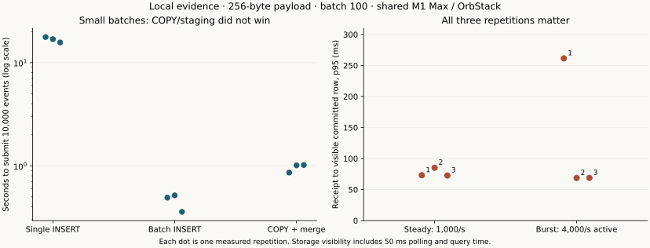

# IngestKit

**What does an event collector actually guarantee when a dependency fails?**

IngestKit is a small Go pipeline that makes that question testable. Send a stable
UUID over HTTP, acknowledge it through Redpanda, and persist it in PostgreSQL.
Stop the database, kill the consumer after a commit, or fail quarantine delivery:
the tests check the resulting IDs and source offsets.

[Read the engineering article](docs/article.md) · [Run the experiments](benchmarks/README.md) · [Delivery contract](docs/delivery.md)

~~~mermaid
flowchart LR
  A[Application] -->|JSON + stable UUID| B[Go API]
  B -->|acknowledged append| C[Redpanda]
  C --> D[Go consumer]
  D -->|COPY staging + merge| E[(PostgreSQL)]
  D -->|malformed envelope| F[Quarantine topic]
  E -. transaction commits before offset .-> C
~~~

## Try it

Requires Docker with Compose v2+ and Go 1.24+. Start with the isolated checkout
demo; it prints the three accepted IDs and verifies each stored row:

~~~sh
git clone https://github.com/feat7/ingestkit.git
cd ingestkit
make demo
make demo-recovery
~~~

The recovery demo stops PostgreSQL, accepts events through the broker, then
restores the database and reconciles the same IDs. Runs have separate projects,
ports and volumes. They stop their services and preserve volumes; each prints
its evidence directory and a command to clean up only that run. Use
`DEMO_FLAGS=-cleanup` for disposable runs.

For an interactive stack:

~~~sh
make up
curl --fail-with-body http://localhost:8080/v1/events \
  -H 'Authorization: Bearer local-demo-key' \
  -H 'Content-Type: application/json' \
  -d '{"event_id":"00000000-0000-4000-8000-000000000001","event_type":"order_completed","occurred_at":"2026-11-03T00:00:00Z","payload":{"order_id":"order-1","amount":25}}'
docker compose exec postgres psql -U ingestkit -d ingestkit_test \
  -c 'SELECT event_id,event_type,payload FROM ingestkit.events;'
make down
~~~

**202 means broker acknowledgement; storage happens afterward.** A failed or
timed-out HTTP request can still have delivered some records. Retry the same
IDs. Storage keeps the first event for each `(tenant_id,event_id)` pair.
[Python and Node callers](examples/checkout/README.md) show the HTTP contract
without installing a generated SDK.

## Evidence, including the awkward result

The historical pipeline timings used Redpanda development mode with a process-
level fsync bypass. Topic write caching was disabled, but that did not disable
this separate bypass. The configuration has now been corrected; replacement
pipeline measurements are pending. The old timings do not establish performance
for the corrected broker configuration.

The database comparison also found batch INSERT faster than the service's
COPY/staging/merge path at batch size 100: median 0.492s versus 1.011s for
10,000 unique submissions. Staging and replay handling have costs. All samples,
settings, source revision and caveats are in [the local results](benchmarks/results/local-2026-11-03/README.md).

Historical figure: its pipeline panel uses the earlier fsync-bypassed broker.

~~~sh
make test
make test-integration
make bench-db
make bench-pipeline
~~~

Tests cover strict envelopes, byte limits, bounded publishing, tenant-scoped
deduplication, database/broker outages, the database-commit/offset-commit crash
window, quarantine failures, rebalance and shutdown. Integration checks use real
isolated services and fail if their setup is missing.

## Scope

This is an engineering reference, with reusable HTTP examples and a small store
implementation. The local broker has one replica and finite retention. Disk/host
loss and outages beyond retention are outside the tested recovery assumptions.
There is no unconditional zero-loss, exactly-once or production-readiness claim.
Deployment hardening, row-level database isolation and business payload schemas
are outside this reference.

The old compiler, generated SDKs, installers and event-specific endpoints were
removed. Existing external releases and legacy data were preserved; legacy data
is not automatically imported. Small workloads may be better served by direct
PostgreSQL writes.

[Architecture](docs/architecture.md) · [Development and configuration](docs/development.md) · [Contributing](CONTRIBUTING.md) · [Apache 2.0 license](LICENSE)
