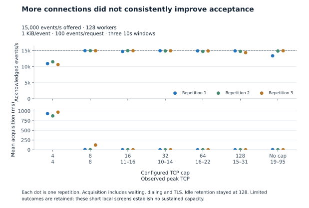
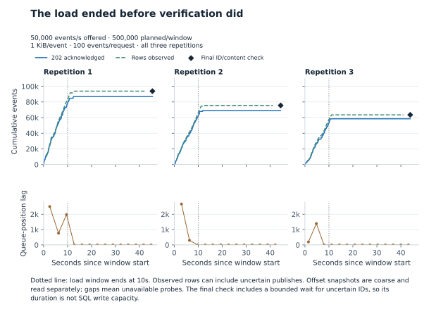

# What limited event ingestion on this machine?

Four TCP connections left the client waiting. Eight reached roughly 15,000
acknowledged events/s in short windows. Raising the cap further introduced
uncertain responses, and offering 50,000 events/s reduced successful acceptance.
The producer's 1,000-record buffer filled; the sampled consumer database pool
showed no new acquisition waits.

These are local screening results from an Apple M1 Max with 64 GiB RAM. OrbStack
provided a shared 10-CPU, roughly 16 GiB Linux VM. The driver ran on macOS beside
the VM. Other host workloads were present. One API, broker, consumer and
PostgreSQL instance ran behind trusted HTTPS, with durability enabled. The
[immutable bundle](results/connections-2026-11-04-7b54d30a/index.json) records
source `043f584`, images, settings and all 36 ingestion windows.

## Connection limits changed the result

Every row below used 128 HTTP workers, 128 idle connections retained per host,
1 KiB payloads and 100 events/request. Each repetition offered 150,000 events
over ten seconds, after a two-second case warm-up. Ranges include all three
repetitions.

| Configured TCP cap | Observed peak TCP | 202-acknowledged events/s inside window | Events with uncertain responses, per repetition |
|---|---|---|---|
| 4 | 4 | 10,640–11,500 | 0 / 0 / 0 |
| 8 | 8 | 14,950–14,970 | 0 / 0 / 0 |
| 16 | 11–16 | 14,730–14,970 | 2,200 / 0 / 100 |
| 32 | 10–14 | 14,880–14,950 | 0 / 700 / 200 |
| 64 | 16–22 | 14,730–14,900 | 700 / 2,400 / 1,000 |
| 128 | 15–31 | 14,360–14,900 | 0 / 2,200 / 6,000 |
| Unlimited | 19–95 | 13,360–14,940 | 15,900 / 900 / 300 |

<a href="../docs/assets/connection-pressure.svg"><picture><source media="(max-width:600px)" srcset="../docs/assets/connection-pressure-mobile.svg"></picture></a>

With a cap of four, as many as 128 HTTP calls were active in the client, but only
four TCP connections were open. Mean connection acquisition took 873–969 ms.
That duration includes transport waiting, dialing and TLS. The cap-eight runs
averaged 1.8–122.9 ms. Idle retention controls which completed connections remain
available for reuse; it does not cap active requests. All measured requests used
HTTP/1.1. HTTP/2 can carry several requests on one connection, so the recorder
tracks sockets and requests separately and has a real multiplexing test.
Counters reset per window after warm-up; an existing socket can be reused
without a new dial or TLS handshake in that window.

## Offering 30k or 50k did not deliver that rate

These cases kept workers, active cap and idle retention at 128, with the same
1 KiB/100-event requests. The 15k row reuses the cap-128 baseline above.

| Offered events/s | Acknowledged events/s inside each window | Events with uncertain responses in each repetition |
|---|---|---|
| 15,000 | 14,900 / 14,750 / 14,360 | 0 / 2,200 / 6,000 |
| 30,000 | 26,030 / 23,860 / 19,110 | 38,900 / 60,700 / 107,100 |
| 50,000 | 7,890 / 6,230 / 5,350 | 396,000 / 430,000 / 424,100 |

At 30k, the driver started all 300,000 planned events in every repetition,
including request tails. At 50k it started 482,900 / 499,000 / 482,600 of the
500,000 planned events. Requests after the window and acknowledgements received
after it are counted separately. The driver never retries load requests.

Every acknowledged ID and its expected content passed an independent SQL check.
Some uncertain publishes also reached storage: 6,930 / 6,549 / 5,008 events in the
50k repetitions. A 503 or lost response therefore remains uncertain; applications
must retry the same IDs. Successful delivery verification does not make an
incomplete offered load a capacity result.

<a href="../docs/assets/acceptance-storage.svg"><picture><source media="(max-width:600px)" srcset="../docs/assets/acceptance-storage-mobile.svg"></picture></a>

The observer keeps a bounded deadline for uncertain IDs that may never appear.
Its final verification duration includes that wait. `VerifiedCompletionEPS`
divides verified rows by the complete window and verification duration; it is an
audit-completion rate. Receipt-to-observed-storage timing includes SQL/polling
delay. Its percentile is unavailable when observation is partial or failed.
Observed-pending counts and saved queue positions are different measurements;
neither is an exact count of rows still needing a database write.

## Which resource showed pressure?

The API producer reached its configured 1,000 buffered records and reported
`buffer_saturated` failures. At 100 events/request, ten fully outstanding
requests can account for 1,000 records; buffers can also contain records from
requests that have already returned an uncertain result. Its separate byte limit
was 64 MiB. Socket counts do not reveal either buffer limit.

The consumer pool allowed ten PostgreSQL connections. Coarse samples showed
zero or one acquired connection, no cancelled acquisitions, and a constant
9.55 ms cumulative empty-pool wait recorded during startup. That wait did not
increase during the sampled study. The writer remained serial. Increasing its
pool limit would have no demonstrated benefit here.

The driver descriptor limit was 245,760; its open-descriptor count was unavailable
on this macOS process and stays null. Service descriptor limits and actual counts
were sampled privately; the API used at most 113 descriptors in those samples.
No driver descriptor-limit error was observed. The manifest includes adapted
Caddy configuration and image defaults; proxy socket counters were unavailable.
These observations support producer pressure and client waiting, without
isolating every cause of the shared machine's performance.

## Larger payloads used a separate, matched cohort

Each case below offered 1,000 events/s with ten events/request, 128 workers and
active/idle caps of 128. A 100-event request with 16 KiB payloads would exceed
the unchanged 1 MiB API body limit. All 10,000 events in each repetition were
acknowledged and verified; a few acknowledgements arrived after the window.

| Payload | Acknowledged events/s inside each ten-second window |
|---|---|
| 256 bytes | 1,000 / 999 / 999 |
| 1 KiB | 998 / 999 / 998 |
| 16 KiB | 995 / 996 / 997 |

All twelve cases retain a `limited` classification, including scheduler delays
and late acknowledgements in otherwise successful cases. The sweep ran in a
fixed order on one deployment; it was not randomized across fresh hosts. Three
ten-second windows cannot establish sustained maximum capacity or an optimal
connection setting for another deployment.

## Reproduce and audit

Use Go, Docker/Compose, Python 3.9+ and a machine with room for the deployment.
Full studies create one owned stack and collect private evidence under ignored
`tmp/runs/`. They remove only their own resources. The recorded run had a separate
host guard; it never triggered, observed at least 38% memory available, and
sampled a driver peak of about 2.86 GiB. Check resources before a new full run.

~~~sh
make bench-study-smoke
make bench-study STUDY_FLAGS='-suite connections -out tmp/studies/connections-new'
python3 benchmarks/audit_study.py benchmarks/results/connections-2026-11-04-7b54d30a --repo .
~~~

The audit checks artifact bytes, request/event accounting, ID hashes, metric
validity, fixed controls, runtime/image fingerprints and historical Git source
bytes. Use a clone containing source revision `043f584`; `--repo` requires its
Git objects. The bundle also contains three TLS-driver calibrations, each with
three windows at 150, 300 and 500 requests/s. They sent the planned work without
misses; one 300 requests/s window acknowledged 100 events after its end. The sink
has no broker or database and provides no ingestion durability result.

~~~sh
go run ./cmd/bench -mode calibrate -rate 50000 -batch 100 -payload 1024 \
  -concurrency 128 -max-conns 128 -max-idle-conns 128 -duration 10s \
  -out tmp/calibration-50000
~~~

`core` remains the default study suite for database, pipeline and recovery
comparisons. It has no replacement published result in this bundle. The reference
COPY method stages rows and merges them for duplicate handling; it is a different
algorithm from direct COPY into the destination. This connection study makes no
new writer-method speed claim.

The previous schema 1 bundles, charts and receipts were archived unchanged with
verified checksums and removed from the public tree. Valid overload observations
in the current bundle are retained. A sustained 30k/50k claim needs a dedicated
deployment, a separate generator and a bounded continuous-run design beyond the
current one-million-events-per-sample guard. See [figure sources](../docs/figures/README.md)
and the [deployment guide](../deploy/README.md).
