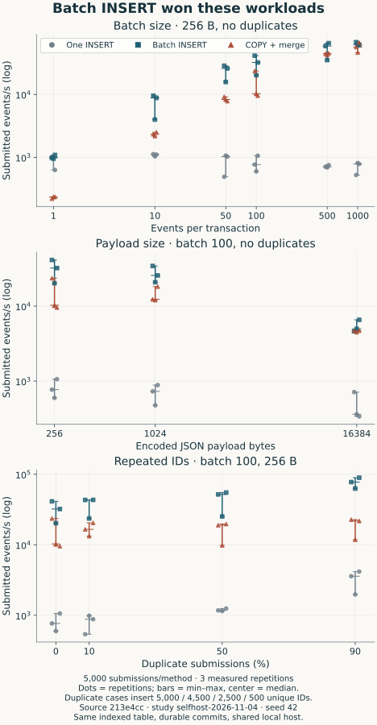
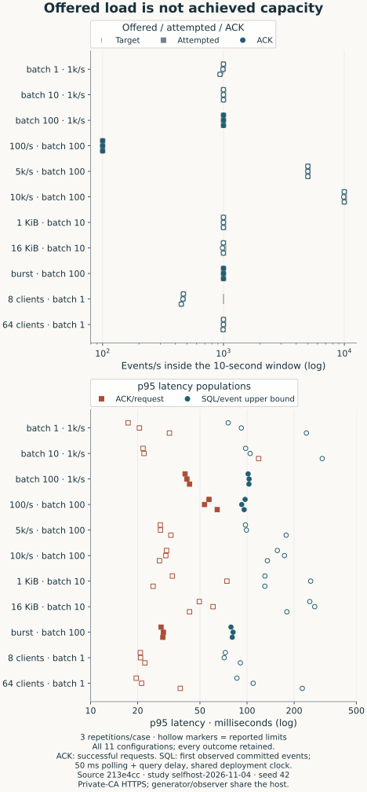
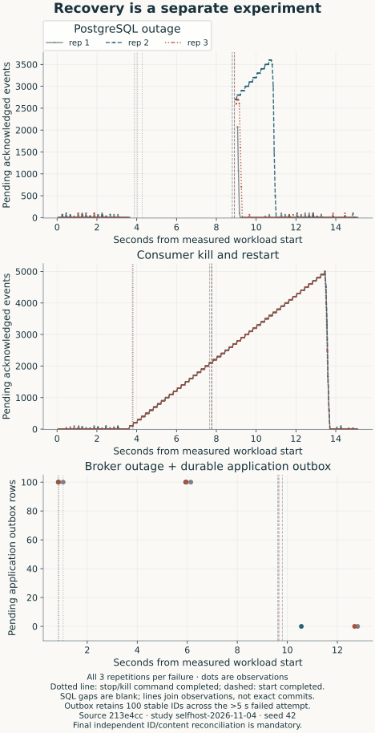

# Building an event collector around the failure boundaries

An HTTP 202 can reach an application while PostgreSQL is unavailable. A failed
HTTP request can also have put some records into a broker. Both are ordinary
outcomes in an asynchronous collector. The useful question is what the caller
should retain, what the consumer can replay, and how to check what survived.

IngestKit is a small Go collector built to make those boundaries inspectable:
HTTPS → Go API → Redpanda → Go consumer → PostgreSQL. It now includes a
self-contained Docker Compose deployment, copyable Python/Node callers and a
working application outbox. The experiments changed the implementation too:
batch INSERT beat the temporary-table COPY/merge strategy in every tested
configuration by median, so the deployed writer became simpler.

This is a publication draft backed by [complete captures and methodology](../benchmarks/results/selfhost-2026-11-04/README.md)
from clean revision [213e4cc](../benchmarks/results/selfhost-2026-11-04/manifest-1.json).
It describes performed local experiments, not production adoption or a maximum
throughput result. The complete earlier COPY-writer study is retained separately.

## Make it something another application can use

The deployment contains the gateway, API, broker, consumer and database. Only
Caddy publishes ports 80/443; database, Kafka, administration and metrics stay
private. The consumer has a restricted writer login, while migrations use a
separate admin login. Named volumes retain database, broker and certificate state.

<a href="assets/deployment.svg"><picture><source media="(max-width:600px)" srcset="assets/deployment-mobile.svg"></picture></a>

A host needs Docker/Compose, Git, OpenSSL and curl. Go builds inside Docker.
With your own DNS hostname pointing to the server and ports 80/443 reachable:

~~~sh
deploy/configure.sh events.example.com
docker compose --env-file deploy/.env -f deploy/compose.yml up -d --build --wait
~~~

The configuration script creates fresh secrets in an ignored file with mode 0600 and
refuses to overwrite an existing configuration. The [deployment walkthrough](../deploy/README.md)
starts at cloning the repository, sends fixed checkout UUIDs and verifies those
same IDs in SQL. Ordinary shutdown preserves volumes. Local tests verify HTTPS
against an explicit private CA; they do not claim to have exercised public DNS
or ACME certificate issuance.

The HTTP contract is deliberately small: UUID, event type, occurrence timestamp
and JSON-object payload. A backend key determines the tenant; the caller cannot
supply a different tenant in its envelope. The API supplies receipt time. Unknown
fields and JSON values that PostgreSQL cannot represent are rejected before
publication. Business-payload validation remains in the application.

The [copyable clients](integration.md) have no package dependencies. They validate
acknowledgement IDs, retry bounded transient/uncertain failures with the same
serialized bytes, and return safe status/request-ID metadata. They keep keys on
a trusted backend. They do not make an in-memory event survive a process crash.

## Start stable IDs in the application transaction

A successful order write followed by an HTTP send has a gap: the process can die
between them. Retrying a request helps only if the application retained the event.
The [transactional outbox pattern](https://docs.aws.amazon.com/prescriptive-guidance/latest/cloud-design-patterns/transactional-outbox.html)
addresses that creation gap by recording business state and pending delivery in
one database transaction, with idempotent handling of repeated dispatch.

The included [SQLite application](../examples/outbox/README.md) makes that concrete.
An order and its serialized event/UUID commit together. Creating the same order
with the same amount returns the original event ID; conflicting business input
fails. A separate one-shot dispatcher reads pending work, releases the SQLite
connection, sends HTTP, and marks matching acknowledgements in another transaction.
It holds no business write lock while waiting on the network.

After loading the backend key as shown in the deployment guide:

~~~sh
export API_URL=https://events.example.com
export INGESTKIT_API_KEY
python3 -m examples.outbox create-order --database private/orders.db \
  --order-id order-123 --amount-cents 2500
python3 -m examples.outbox dispatch --database private/orders.db
python3 -m examples.outbox status --database private/orders.db
~~~

The states are precise. `pending` still needs broker acknowledgement;
`acknowledged` means matching HTTP 202 IDs, with PostgreSQL potentially catching
up; `rejected` keeps a permanent 400/413 visible for repair. Authentication or
network failures do not silently discard business events.

There is another crash gap after the broker ACK but before the dispatcher marks
its local row. A deterministic integration test pauses a test-only wrapper after
an actual HTTP ACK, kills that child and dispatches again. The new process uses
the saved UUID/body, and PostgreSQL still has one row. This example supports one
dispatcher; multiple dispatchers need a claim/lease protocol in the application's
own database. SQLite is the runnable example, not a requirement to add a second
database to an application that already has transactions.

## Put SQL before source progress

The API waits for every broker acknowledgement covered by its response. The
publish deadline is five seconds and buffering is bounded. HTTP batches are
validated together, but are not broker transactions: an error can follow partial
publication. A retry therefore reuses IDs rather than inventing replacements.

The consumer's normal valid-record path is short:

1. Read a bounded segment from a source partition.
2. Execute one multi-row INSERT with `ON CONFLICT DO NOTHING`; commit PostgreSQL.
3. Commit the handled source offsets.

The unique key is `(tenant_id,event_id)`. A crash after step 2 and before step 3
leaves stored rows with pending offsets. A replacement consumer replays them;
conflicts preserve the first stored content. Reusing a UUID for different content
is a caller error, not an update operation.

<a href="assets/delivery.svg"><picture><source media="(max-width:600px)" srcset="assets/delivery-mobile.svg"></picture></a>

[Open the full sequence](assets/delivery.svg). HTTP response timing and consumer
processing can overlap after broker acceptance. The diagram's alternative segment
does not imply that already committed offsets replay.

This is an idempotent storage effect, not a transaction spanning Kafka and
PostgreSQL. [Kafka's delivery-semantics discussion](https://kafka.apache.org/41/design/design/)
is useful context: Kafka-to-Kafka transactions do not automatically make an
external database write atomic with an offset update.

Malformed broker envelopes take a separate acknowledged quarantine path. Source
progress cannot skip a record whose quarantine write failed. A database outage
is retried, not treated as malformed data. The [delivery contract](delivery.md)
spells out these conditions and the finite retention/disk assumptions.

## Test the crash window deliberately

Randomly restarting a consumer is useful, but does not prove it died in the
SQL-commit/offset-commit gap. The deterministic regression wraps the real store,
pauses just after database commit, kills only that helper process, checks that
the source offset is still pending and starts a replacement in the same group.
Replay encounters the duplicate and advances progress; SQL still contains one row.

Other real-service checks deny INSERT while database Ping still succeeds,
restore the grant and verify processing readiness; rotate overlapping API keys;
and restore a custom-format backup into a separate empty owned deployment while
preserving the source. Safe consumer diagnostics report operation, error class,
SQLSTATE and source coordinates, with repeated errors throttled. They exclude
raw errors, credentials and payloads. Connectivity is not sufficient evidence of
successful processing.

## Measure the write path you actually deploy

[PostgreSQL's bulk-loading guidance](https://www.postgresql.org/docs/18/populate.html)
explains why per-row commits are expensive and why COPY is useful for large
loads. This collector's original strategy did more work than plain COPY into
an empty table: create a temporary table, COPY into it, merge into an indexed
target with conflict handling, then commit. The comparison measures complete
strategies; it does not isolate the cost of each extra operation.

The corrected study compares single INSERT, batch INSERT and that explicit
COPY/staging/merge reference. Each method gets 5,000 submissions, the same schema,
indexes, conflict policy and enabled database durability. Generation, reset,
warm-up and exact verification are outside elapsed time; order rotates across
three repetitions. Single INSERT commits every row, the others every batch.

For 256-byte payloads, no duplicates and batch 100, the final study recorded
these median and min–max seconds across all three repetitions:

| Method | Median (s) | Range (s) |
| --- | ---: | ---: |
| Single INSERT | 6.510 | 4.710–8.375 |
| Batch INSERT | 0.155 | 0.121–0.247 |
| COPY/staging/merge | 0.486 | 0.212–0.523 |

The broader sweep covers batch sizes 1–1000, payloads up to 16 KiB and 10/50/90%
duplicate submissions. Batch INSERT had the lower median than COPY/merge in all 11
configurations in both studies. Some individual repetitions overlap or reverse
that ordering. Duplicate cases insert fewer unique rows, so their submitted/s
is not a clean percentage estimate of deduplication overhead.

<a href="assets/database-batching.svg"><picture><source media="(max-width:600px)" srcset="assets/database-batching-mobile.svg"></picture></a>

That evidence changed the default to one atomic batched INSERT. Existing rollback,
deduplication and deterministic replay tests still pass; the deployed role no
longer needs temporary-table privilege. COPY remains a distinct reference in the
benchmark, rather than a label that silently follows the current default. A new
complete study was run from the resulting committed code.

This result does not identify a universal COPY crossover. It does not compare
UNNEST or typed tables. [Tiger Data's batch-ingest exploration](https://www.tigerdata.com/blog/benchmarking-postgresql-batch-ingest)
compares different bulk-loading methods and sizes; its numbers should not be
transferred to this indexed, conflict-handling JSONB workload.

## An offered rate is not a capacity result

The HTTPS suite has 11 load configurations with three measured windows each.
The baseline offers 1,000 events/s for ten seconds, in batches of 100 with 32
clients and 256-byte payloads. Warm-up is two seconds; target SQL polling is 50 ms.
Larger payloads use batch 10 to stay below the existing request cap.

All three baseline windows attempted, acknowledged and independently verified
10,000 events each, without reported limits. HTTP ACK p95 was 40.19–42.92 ms;
receipt-to-observed-storage p95 was 101.61–103.08 ms. Those are different populations:
one sample per successful request versus one per observed event.

The rest of the report is less tidy, and should stay that way. Smaller batches
show generator misses or boundary tails. At 10,000 offered/s, repetition 2 retained
1,000 ambiguous IDs absent at its final deadline; the 16 KiB case's second repetition
retained 160. They remain unknown, not proved never delivered, and are not counted
as acknowledged success. A caller should retain and retry their original IDs.

<a href="assets/pipeline-load.svg"><picture><source media="(max-width:600px)" srcset="assets/pipeline-load-mobile.svg"></picture></a>

A late acknowledgement at the edge of a finite window does not itself prove
saturation. Neither do missed generator schedules identify the collector's
capacity. In-window ACK rate excludes late ACKs. Stored rate includes the whole
window, request tail, observation drain and final verification. Selecting the
best repetition or dividing later rows by an earlier denominator would tell a
different, misleading story.

The SQL metric is an upper bound: API receipt through the first completed query
that sees a committed row, including polling/query overhead. `persisted_at` alone
is not a commit clock. The observer uses a connection-owned pending-ID relation,
so a transaction committing late cannot fall behind a timestamp cursor. Final
ID/content verification is independent; rows discovered only then receive no
invented latency sample. Receipt and SQL observation share the deployment clock,
while the host schedules load with monotonic timing.

## Recover, then reconcile

The three availability experiments each run three repetitions:

- PostgreSQL stop requested at 3s and start at 8s during a 15-second workload.
- Consumer KILL requested at 3s and restart at 5s during the same offered 500/s load.
- Broker stopped for eight seconds after stop completion, while 100 durable outbox
  events survive a failed attempt lasting more than the five-second publish deadline.

Every acknowledged ID/content reconciled after the database and consumer cases.
In the outbox case, a new dispatcher replayed the saved events to 100 accepted and
stored unique IDs per repetition. Container start completion is not the same as
catching up source progress. Actual control timestamps and all repetitions are
retained; SQL-observer outages appear as gaps.

<a href="assets/recovery.svg"><picture><source media="(max-width:600px)" srcset="assets/recovery-mobile.svg"></picture></a>

These are availability experiments, not throughput headlines or exhaustive
failure proofs. They complement the exact crash-window regression. The
[operator guide](operations.md) covers readiness, lag, disk growth, key rotation
and backup/restore. Restoring an older database does not rewind committed broker
offsets: replay must be deliberate and can recover only data still retained.

## Keep the limits with the result

The environment was an M1 Max physical host with an OrbStack Linux Docker VM,
with generator and SQL observer sharing that machine alongside existing workloads.
The broker had one core and 1 GiB; the VM exposed 10 CPUs and about 16 GiB. Coarse Docker
snapshots do not establish a sole bottleneck or a cloud-cost estimate.

The new manifests inspect the actual broker process's fsync-bypass flag, topic
write caching, database durability, image IDs/digests and trusted HTTPS protocol.
An earlier development-mode capture had process-level fsync bypass enabled even
though topic write caching was false. It remains [historical with an erratum](../benchmarks/results/local-2026-11-03/README.md);
these corrected studies do not reuse it as deployment-performance evidence.

The project has one broker replica and finite log retention on one host. It does
not protect against losing that host or its disks. Applications own business
schemas and IDs; operators own disk monitoring, backups and any SQL retention
policy. Direct PostgreSQL writes may be a better choice when a broker adds no
useful buffering or recovery boundary.

Related reading includes [PostHog's capture/processing separation](https://posthog.com/docs/how-posthog-works/ingestion-pipeline)
and [Segment's client-ID deduplication discussion](https://www.twilio.com/en-us/blog/insights/exactly-once-delivery).
Their systems have different storage, scale and guarantees. Here, the reusable
parts are the deployable HTTP boundary, durable application outbox, explicit
commit ordering and experiments that keep their unknowns visible.
