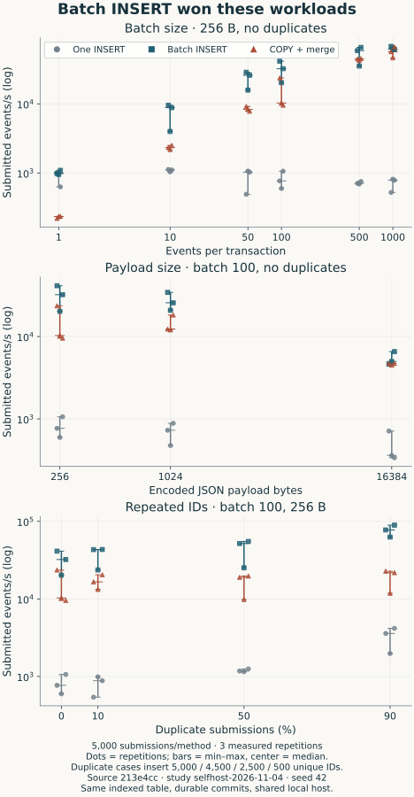
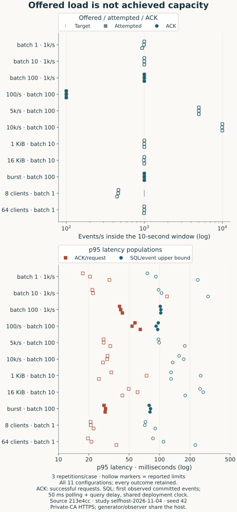
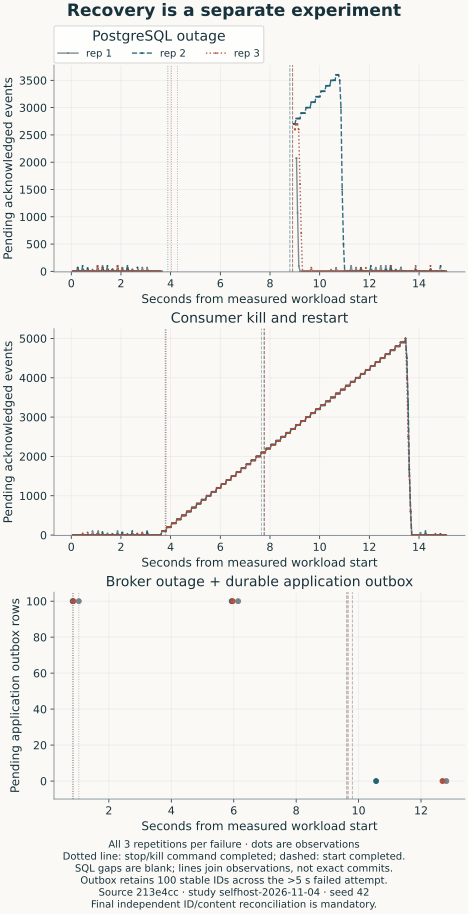

# Diagrams and experiment plots

Start with the two event-story diagrams. One follows a request to storage; the
other shows the exact place a worker can stop and safely read the event again.
The architecture and sequence sources point to runtime revision 799106a.

## Where does an event wait?

<a href="../assets/event-journey.svg"><picture><source media="(max-width:600px)" srcset="../assets/event-journey-mobile.svg"></picture></a>

The API returns 202 after queue acknowledgement. PostgreSQL may still be pending.
This is the logical event path: the endpoint groups Caddy and the Go API. The
[full deployment map](../assets/deployment.svg) and
[phone map](../assets/deployment-mobile.svg) show the separate services and their
public/private ports.

## Why does replay keep one row?

<a href="../assets/worker-replay.svg"><picture><source media="(max-width:600px)" srcset="../assets/worker-replay-mobile.svg"></picture></a>

The unique tenant/event ID key makes the repeat safe. The
[full request sequence](../assets/delivery.svg) and
[phone guide](../assets/delivery-mobile.svg) include HTTP acceptance as well.
HTTP responses and worker processing can overlap after queue acceptance.

## How does batching affect writes?

<a href="../assets/database-batching.svg"><picture><source media="(max-width:600px)" srcset="../assets/database-batching-mobile.svg"></picture></a>

Each panel changes one input. Dots show all three runs; marks show the median
and min/max, not confidence intervals. Duplicate workloads submit more events
than the number of new rows inserted. Read those two rates separately. The
[results](../../benchmarks/results/selfhost-2026-11-04/README.md) explain why the
measured comparison led to batch INSERT.

## Did the HTTP client send its target load?

<a href="../assets/pipeline-load.svg"><picture><source media="(max-width:600px)" srcset="../assets/pipeline-load-mobile.svg"></picture></a>

Compare the target with attempted and acknowledged counts before reading latency.
Hollow points retain cases with limits, including responses just outside the
window. ACK timing samples requests; SQL timing samples events first seen in
committed rows and includes polling/query delay. Neither establishes maximum capacity.

## What happened during the outages?

<a href="../assets/recovery.svg"><picture><source media="(max-width:600px)" srcset="../assets/recovery-mobile.svg"></picture></a>

Blank sections are SQL observation gaps. Fault lines mark Docker control completion,
not the exact moment a service became usable. Outbox points are saved snapshots,
with no fabricated line between them. In the database and worker panels, pending counts queue-acknowledged events the
SQL observer has not yet seen. That observation count is not an instantaneous
database or Kafka backlog. In the outbox panel, pending counts application rows
not yet marked acknowledged locally; their delivery outcome can be uncertain.
Read [all outcomes and controls](../../benchmarks/results/selfhost-2026-11-04/README.md)
with the plots.

## Regenerate the measured plots

[verification.json](verification.json) records the original export and chart
checks. [story-verification.json](story-verification.json) covers the new diagrams
and their phone guides. The charts use the [audited study index](../../benchmarks/results/selfhost-2026-11-04/index.json),
including all runs and limits, from source
[213e4cc](../../benchmarks/results/selfhost-2026-11-04/manifest-1.json).
They do not use the earlier fsync-bypassed pipeline samples.

The recorded chart tools were Python 3.12.14 and matplotlib 3.11.2. In a Python
3.12 environment, run from the repository root:

~~~sh
python3 -m venv .venv
.venv/bin/pip install matplotlib==3.11.2
.venv/bin/python benchmarks/plot_results.py \
  --study benchmarks/results/selfhost-2026-11-04 --output docs/assets
python3 docs/figures/render_mobile_guides.py
~~~

The generator audits the capture first. It fixes SVG IDs, omits timestamps and
embeds font outlines. `--preview-dir tmp/figure-previews` also writes PNGs.
Phone plots use larger type and stacked legends with the same measurements.
These are optional development tools; deployed services and copied clients do
not need matplotlib.

## Regenerate the event-story diagrams

[event-journey.architecture.json](event-journey.architecture.json) and
[worker-replay.sequence.json](worker-replay.sequence.json) include their source
ranges. Set `ARCHIFY_CLI` to the installed Archify 3.2.0 `bin/archify.mjs` path:

~~~sh
node "$ARCHIFY_CLI" finalize architecture docs/figures/event-journey.architecture.json \
  .archify/architecture-event-journey-20261104-123448/event-journey.html \
  --repo-root "$PWD" --quality showcase --json
node "$ARCHIFY_CLI" finalize sequence docs/figures/worker-replay.sequence.json \
  .archify/sequence-worker-replay-20261104-123448/worker-replay.html \
  --repo-root "$PWD" --quality showcase --json
python3 docs/figures/render_story_guides.py
~~~

Open the HTML and choose Export, then SVG Auto. Save the diagram exports as
`docs/assets/event-journey.svg` and `docs/assets/worker-replay.svg`. They adapt
to light/dark themes and exclude viewer controls. The small phone SVGs are reading
guides generated by [render_story_guides.py](render_story_guides.py); they explain
the same behavior without shrinking a full trace onto a phone.

## Reproduce the detailed technical views

[deployment.architecture.json](deployment.architecture.json) and
[delivery.sequence.json](delivery.sequence.json) describe the measured runtime
at 213e4cc. They passed Archify showcase, strict-artifact and real-browser checks.
Their HTML and receipts live under ignored `.archify/`:

~~~sh
node "$ARCHIFY_CLI" finalize architecture docs/figures/deployment.architecture.json \
  .archify/architecture-deployment-20261104-041835/deployment.html \
  --repo-root "$PWD" --quality showcase --json
node "$ARCHIFY_CLI" finalize sequence docs/figures/delivery.sequence.json \
  .archify/sequence-delivery-20261104-041835/delivery.html \
  --repo-root "$PWD" --quality showcase --json
~~~

Export SVG Auto as `docs/assets/deployment.svg` and `docs/assets/delivery.svg`.
The repository identity uses SSH, so source navigation is local-only. A changed
candidate needs fresh browser evidence as described by Archify. The original
compact guides come from [render_mobile_guides.py](render_mobile_guides.py).

Figures were checked at 800px content width and a 390px phone viewport. Plot
panels keep an opaque light background for contrast; diagram exports follow
the host theme. Export hashes identify the files that were checked.
